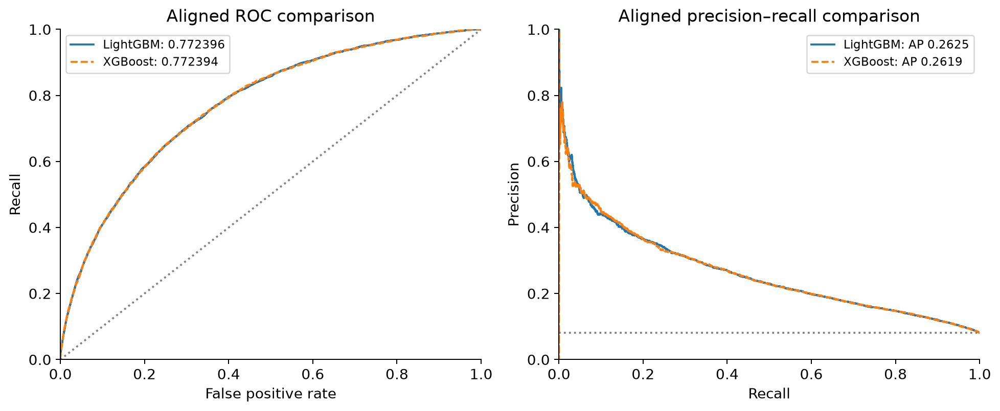

# Home Credit Default Risk

MSDM5054 Statistical Machine Learning, Mini-Project 1, Hong Kong University of Science and Technology.

## Overview

This project predicts repayment difficulty from Home Credit application data. We compare logistic regression, LightGBM and XGBoost using exploratory data analysis, feature engineering and a shared validation protocol.

The labelled application table contains 307,511 rows; the test table contains 48,744 rows. Experiments use a stratified 80/20 split with seed 42 and five-fold cross-validation within the training partition.

## Main findings

| Model | Fixed-validation ROC AUC | Five-fold mean ROC AUC |
| --- | ---: | ---: |
| V0 logistic regression | 0.751239 | — |
| V0 LightGBM | 0.759364 | — |
| V1 LightGBM baseline | 0.769522 | 0.763755 |
| V1 regularized LightGBM | 0.772396 | 0.766092 |
| V1 XGBoost, selected | 0.772394 | 0.767210 |

- The V1 feature and preprocessing package provides the largest improvement over the V0 baseline. It retains 65 original features and adds `ANNUITY_TO_CREDIT`, producing 83 numeric model inputs.
- XGBoost is selected for its slightly higher CV mean and lower observed fold variability. Its fixed-validation AUC is effectively tied with regularized LightGBM; no significant superiority is established.
- The final report records XGBoost Kaggle scores of **0.76656 public** and **0.76225 private**.
- A default classification threshold of 0.50 detects only 2.88% of validation positives. Lower thresholds increase recall and false positives together.

Both fixed-validation models used early stopping on the validation set, and feature selection preceded inner CV. The reported validation metrics are development estimates.



## Report and supporting artifacts

| Artifact | Location |
| --- | --- |
| Final report | [report.pdf](docs/report/report.pdf) |
| LaTeX report source | [report.tex](docs/report/report.tex) |
| Selected XGBoost submission | [submission_v2_xgboost.csv](results/submissions/submission_v2_xgboost.csv) |
| Validation metrics | [aligned_model_metrics.csv](results/evaluation/aligned_model_metrics.csv) |
| Cross-validation summary | [cv_summary.csv](results/evaluation/cv_summary.csv) |
| Feature decisions | [column_decisions.md](docs/eda/column_decisions.md) |

## Repository structure

```text
.
├── README.md
├── CONTRIBUTING.md
├── requirements.txt             # Full workflow installation entry point
├── requirements/
│   ├── base.txt                 # Baseline, EDA and notebook dependencies
│   ├── modeling.txt             # LightGBM and XGBoost
│   ├── evaluation.txt           # Evaluation without retraining
│   └── locks/                   # Recorded environment snapshots
├── docs/
│   ├── data/                    # Fingerprints, split and preprocessing protocols
│   ├── eda/                     # Findings and feature decisions
│   ├── modeling/                # Modeling stage handoff
│   ├── evaluation/              # Evaluation stage handoff
│   ├── report/                  # Final PDF, LaTeX source and archive/
│   └── division-of-labor.md      # Historical development agreement
├── notebooks/
│   ├── 01_data_and_baseline.ipynb
│   ├── 02_modeling.ipynb
│   └── 03_evaluation.ipynb
├── src/                         # Shared data, baseline and evaluation modules
├── scripts/eda/                 # EDA and figure-generation scripts
├── tests/                       # Evaluation input and alignment checks
├── results/
│   ├── baseline/                # V0 metrics, figures and earlier snapshots
│   ├── eda/                     # Feature statistics and figures
│   ├── modeling/                # CV, configs, predictions and fitted estimators
│   ├── evaluation/              # XGBoost results and LightGBM comparison
│   └── submissions/             # Full-data prediction CSVs
└── data/                        # Local raw and processed data; ignored by Git
```

## Team contributions

| Member | Contribution |
| --- | --- |
| SHU Yi | Data entry, fixed split, V0 baseline and submission validation |
| CAO Yixin | EDA, feature decisions, analysis figures, Kaggle submission, NeurIPS report conversion and repository organization |
| ZHANG Yajing | LightGBM and XGBoost, cross-validation, tuning, model selection and full-data prediction generation |
| SU Zhiyu | Recomputed metrics, aligned model comparison, error analysis, evaluation figures and integrated report |

Environment setup, reproduction steps and execution entry points are documented in [CONTRIBUTING.md](CONTRIBUTING.md).
