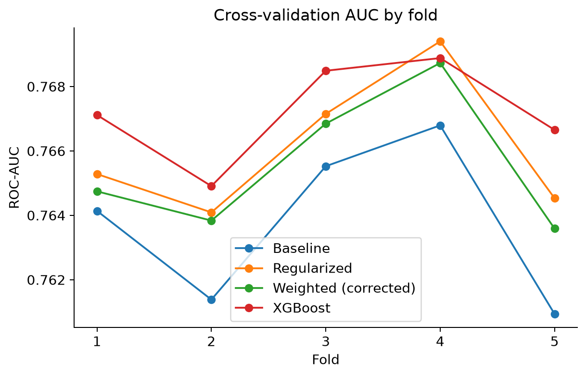
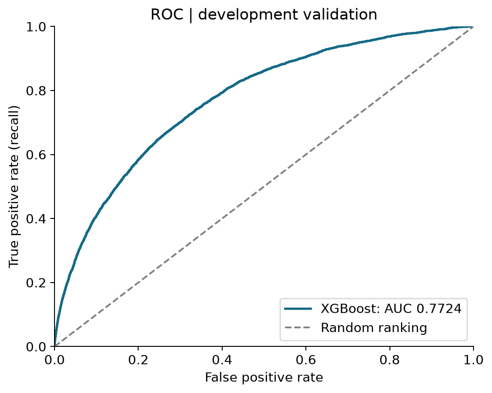
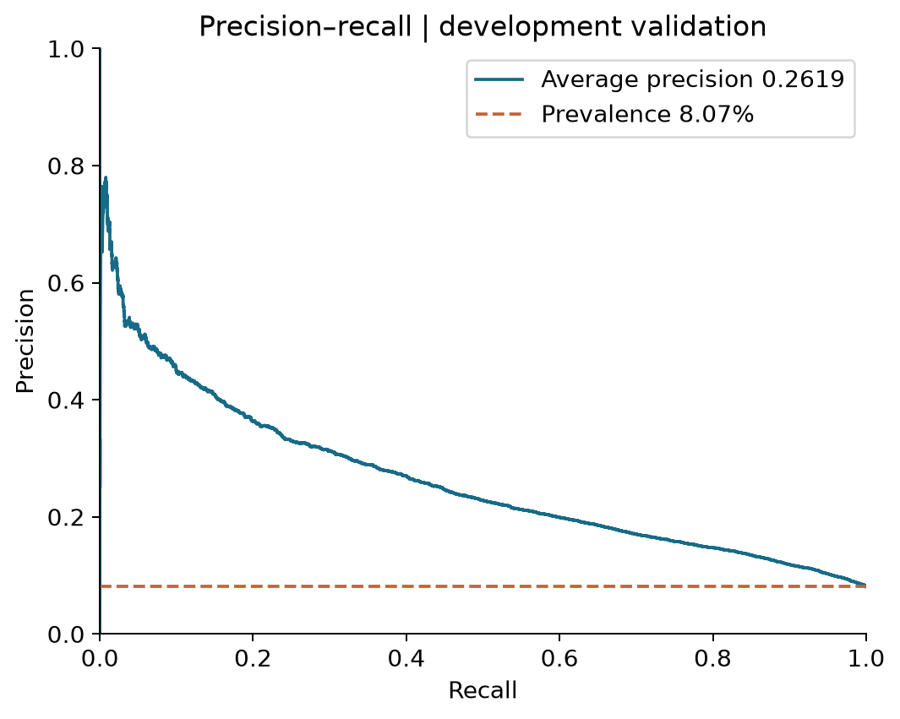
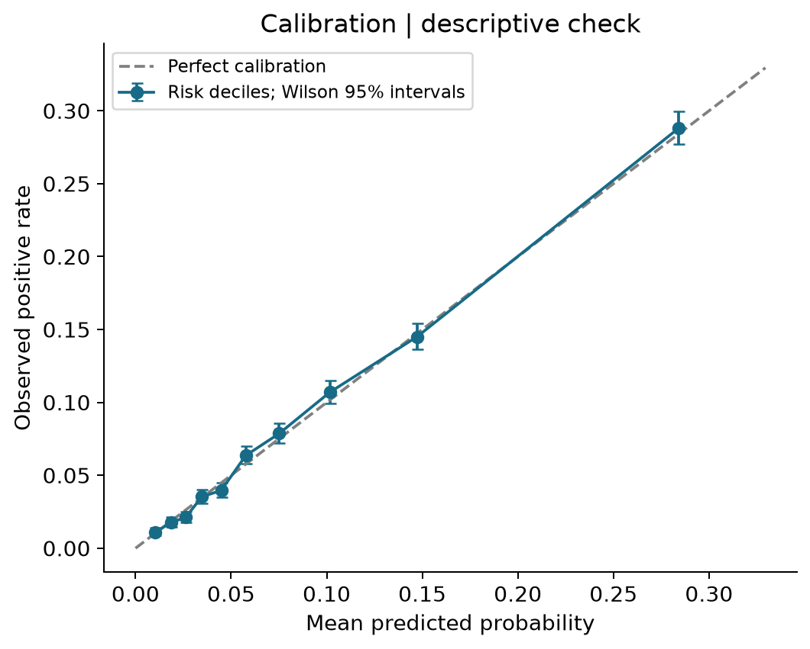
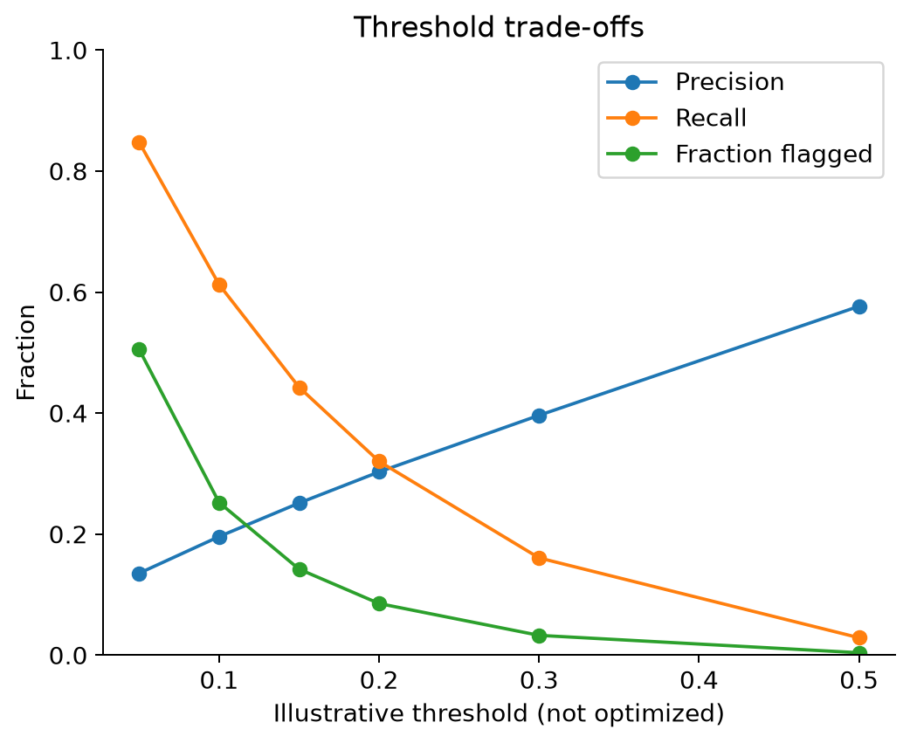
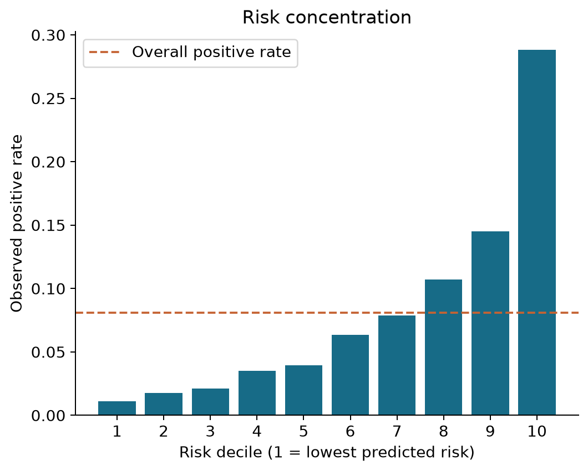

> Historical draft. The final submission and reported Kaggle scores are in [report.pdf](../report.pdf).

# Home Credit Default Risk
## Model evaluation and integrated project report
**MSDM5054 · SHU Yi, CAO Yixin, ZHANG Yajing, SU Zhiyu**

Updated 9 October 2026 · Modeling source snapshot `8d44b49`

## Abstract
This project predicts repayment difficulty from the Home Credit application main table. A stratified split assigns 246,008 applications to training and 61,503 to development validation. The workflow compares logistic regression, LightGBM and newly added XGBoost using V1 features. We select **XGBoost** based on a slightly higher five-fold mean ROC-AUC: **0.767210**, compared with **0.766092** for regularized LightGBM. Using the same sample-standard-deviation convention, fold variability is **0.001586** versus **0.002189**. On the fixed validation set, the models are effectively tied: XGBoost AUC **0.772394**, LightGBM **0.772396**. We independently recompute metrics from both prediction files and focus the error and calibration analyses on XGBoost. Neither the tiny fixed-set difference nor the five-fold comparison establishes significant superiority. Both models used validation early stopping; these remain development results, not untouched test estimates or Kaggle scores.

## 1. Research questions and data
The project asks whether application information can rank repayment risk; whether the V1 feature and preprocessing package improves on the V0 baseline; and how ranking performance translates into errors at different classification thresholds. TARGET=1 denotes the competition's repayment-difficulty class, referred to here as the positive class. Results do not establish causal effects or prescribe lending decisions.

The official labelled application table contains 307,511 rows and the official test table contains 48,744 rows. The implemented experiments use the application main table only; multi-table aggregation has not been implemented. ID `SK_ID_CURR` and TARGET are excluded from predictor inputs. The fixed split uses seed 42 and stratification by TARGET. The evaluation dataset contains 61,503 distinct IDs, 4,965 positives and 56,538 negatives. Raw data are not in this source archive. We verified the exported prediction schema, ID uniqueness, label validity and probability range; independent comparison against canonical raw labels and split membership remains unavailable.

## 2. Data preparation and feature engineering
The data pipeline implements input-file fingerprints, fixed split reproduction and training-only preprocessing. V0 replaces the DAYS_EMPLOYED sentinel 365243 with missing values, applies log1p to four monetary variables, drops features with over 80% training missingness, and uses numeric imputation/scaling plus categorical one-hot encoding. The logistic classifier is part of a single fitted pipeline.

Our training-partition exploratory data analysis identifies missingness patterns, extreme values, near-constant fields and correlated feature groups. The V1 decision list retains 65 original features, removes 55 and adds ANNUITY_TO_CREDIT. Thus 66 raw features become 83 numeric model inputs after additional indicators. V1 changes the preprocessing package as well as feature selection: training-fitted caps and bins, rare-category merging, cross-fitted target encoding for two high-cardinality fields, and ordinal encoding for other categories. Therefore the V0-to-V1 improvement cannot be attributed solely to the single ratio feature. Our univariate screening and permutation analysis emphasize the external-source scores, but such associations are not causal and do not prove the absence of all leakage.

## 3. Model development and current selection
We first fit logistic regression and LightGBM, then apply the V1 feature/preprocessing package and regularization. XGBoost uses the same 83-column representation, fixed 80/20 split and five-fold partitioning within the 80% training portion. Learned preprocessing is fitted within each CV fold. Feature selection itself was already performed on the larger training portion, so the procedure is not nested validation of feature selection.

XGBoost uses binary logistic loss, learning rate 0.03, max depth 6, row and column subsampling 0.8, alpha 0.1, lambda 1.0 and histogram-based trees. Early stopping monitors AUC. Its best CV round counts are 694, 477, 582, 793 and 805; their rounded mean is **670**. The model-selection record, `selected_model.json`, identifies V1 XGBoost as the selected model because its CV mean is slightly higher and its observed fold variability is lower. This selection is an empirical preference in the tested configurations, not evidence of universal superiority.

### Validation models and full-data models
| Model | Fixed-validation fitted model | Separate full-data fitted model |
|---|---|---|
| Regularized LightGBM | Validation early stopping selected 892 rounds | 705 rounds selected from CV; 307,511 training rows |
| XGBoost | `best_iteration=777` (zero-based), i.e. 778 rounds | 670 rounds selected from CV; 307,511 training rows |

The record-level validation files come from the first column. Full-data estimators in the second column have no independent validation score. The official test set has 48,744 rows; we retain validated submission candidates for both models, without any Kaggle leaderboard score. The filename `submission_v2_xgboost.csv` identifies a submission version; XGBoost still uses the **V1 feature pipeline**, not a new multi-table V2 feature set.

## 4. Evaluation and input checks
Our evaluation pipeline reads both models’ prediction files, requires 61,503 rows, checks unique nonmissing customer IDs, binary labels and finite probabilities in [0,1], and recomputes AUC against each configuration. Before comparing models, we join by **SK_ID_CURR**, verify equal ID sets and check that labels agree. Row ordering is not assumed. This confirms consistency between the two prediction exports, not independent correctness against the unavailable canonical raw data.

ROC-AUC measures ranking; Average Precision (AP) summarizes precision-recall performance using `average_precision_score`, not trapezoidal PR-AUC. Brier score and log loss measure probability quality. The positive rate is **8.07%**: predicting all applications negative gives **91.93% accuracy** and zero recall. Thus accuracy alone is misleading.

For XGBoost, a 500-replicate stratified percentile bootstrap (seed 42) yields AUC interval **[0.7656, 0.7796]**. It conditions on fixed predictions and does not account for model selection, early stopping or training variability. Wilson intervals in calibration plots describe within-bin positive-rate uncertainty only. Input hashes and package versions are in `results/evaluation/provenance.json`; LightGBM details are retained under `results/evaluation/lightgbm/`.

## 5. Updated model comparison
| Experiment | Fixed validation AUC | CV mean AUC |
|---|---:|---:|
| V0 Logistic Regression | 0.751239 | — |
| V0 LightGBM | 0.759364 | — |
| V1 LightGBM baseline | 0.769522 | 0.763755 |
| V1 Regularized LightGBM | 0.772396 | 0.766092 |
| V1 Regularized + class weight (corrected) | — | 0.765550 |
| **V1 XGBoost — selected model** | **0.772394** | **0.767210** |

Historical results are taken from the modeling experiments; we independently recompute both regularized LightGBM and XGBoost fixed-validation AUCs from the exported predictions. The CV mean difference is **+0.001118** in favor of XGBoost. Fixed-validation AUC difference (XGBoost minus LightGBM) is **-0.000001528**, effectively a tie. There is no observed improvement in fixed-validation AUC for XGBoost.

### Consistent reporting of fold variability
| Model | CV mean | Sample SD (`ddof=1`, comparison standard) | Population SD (`ddof=0`) |
|---|---:|---:|---:|
| Regularized LightGBM | 0.766092 | 0.002189 | 0.001958 |
| XGBoost | 0.767210 | 0.001586 | 0.001418 |

The XGBoost experiment in the modeling notebook uses `np.std` with its default `ddof=0`; its LightGBM calculation uses `ddof=1`. We retain the original experiment records and recalculate both standard deviations using a common convention. XGBoost still has lower observed fold variability after harmonization. These SDs are not standard errors or confidence intervals, and no significance claim is made from five folds. Baseline/regularized LightGBM CV does not explicitly restrict early stopping to AUC alone, while XGBoost and corrected weighted LightGBM do; this limits how strictly controlled the comparison is.

## 6. Independently recomputed fixed-validation metrics
| Metric | Regularized LightGBM | XGBoost |
|---|---:|---:|
| ROC-AUC ↑ | 0.772396 | 0.772394 |
| Average precision ↑ | 0.262523 | 0.261932 |
| Brier score ↓ | 0.066919 | 0.066902 |
| Log loss ↓ | 0.241821 | 0.241746 |

The models are very similar. XGBoost has slightly lower probability losses, while LightGBM has slightly higher AP and essentially identical AUC. The data do not support a claim that one model dominates all metrics. Our model-selection preference is driven primarily by CV. The ROC and PR curves below use aligned predictions from the same 61,503 applications.

The following plots and sections focus on selected **XGBoost**, with complete LightGBM results retained in the comparison subfolder.

XGBoost mean predicted risk is 8.0070%, versus observed prevalence 8.0728%. Its Brier score 0.066902 is below the descriptive constant-validation-prevalence reference 0.074211. That reference is not a separately trained model. Similar average predicted and observed risk does not establish calibration for every score range or subgroup.

## 7. XGBoost thresholds and error analysis
Thresholds are prespecified illustrative comparisons, not optimized business decisions. Predict class 1 when probability is greater than or equal to the threshold.

| Threshold | True positive | False positive | False negative | Precision | Recall | Fraction flagged |
|---|---:|---:|---:|---:|---:|---:|
| 0.05 | 4,209 | 26,876 | 756 | 13.54% | 84.77% | 50.54% |
| 0.10 | 3,041 | 12,474 | 1,924 | 19.60% | 61.25% | 25.23% |
| 0.15 | 2,198 | 6,544 | 2,767 | 25.14% | 44.27% | 14.21% |
| 0.20 | 1,590 | 3,659 | 3,375 | 30.29% | 32.02% | 8.53% |
| 0.30 | 798 | 1,215 | 4,167 | 39.64% | 16.07% | 3.27% |
| 0.50 | 143 | 105 | 4,822 | 57.66% | 2.88% | 0.40% |

At 0.50, XGBoost flags **248** applications and detects only **143 / 4,965** positives (recall **2.88%**); it misses **4,822** positives despite accuracy **91.99%**. At 0.10, recall rises to **61.25%**, with **12,474** false positives and precision **19.60%**. Compared with LightGBM at 0.10, XGBoost catches 40 additional positives but also produces 217 additional false positives. This is a trade-off, not an unconditional improvement.

At threshold 0.10, XGBoost false negatives have median predicted probability 0.0583 and false positives 0.1539. Overlapping score distributions explain why lowering the threshold increases detection and false alarms together. Available inputs support score-based error analysis, but not claims about age-, income- or occupation-specific mistakes. A future operational threshold requires explicit costs or capacity, selected using training-side out-of-fold predictions and assessed on fresh data.

## 8. XGBoost risk concentration and feature interpretation
The highest-risk decile contains **6,151** applications and **1,772** positives. Its positive rate is **28.81%**, about **3.57 times** the overall rate; it contains **35.69%** of all positives. The lowest-risk decile's positive rate is **1.11%**. Quantile bins are descriptive groupings of these validation predictions, not frozen production cutoffs.

The XGBoost importance export comes from the **670-round full-data model**, not the 778-round validation model. Its normalized gain ranking is led by EXT_SOURCE_2, EXT_SOURCE_3 and EXT_SOURCE_1, followed by NAME_EDUCATION_TYPE and FLAG_OWN_CAR. It does not provide the direction of effects and is not SHAP or causal evidence. LightGBM's exported importance is split count, so the two importance columns should not be compared numerically. The exploratory permutation-importance analysis also uses a different model and method.

## 9. Limitations and next steps
1. Both fixed-validation models used the same evaluation set for early stopping and it was examined during development. Neither result is an unbiased untouched-test estimate. Freezing a CV-derived iteration count does not undo prior validation reuse.
2. Feature selection precedes inner CV. Foldwise preprocessing is appropriate, but the whole feature-selection process is not nested. Early-stopping criteria differ across some model configurations.
3. XGBoost and LightGBM predictions are now aligned for direct descriptive comparison. No paired significance test is reported, and earlier logistic/V0 models still lack exported record-level predictions in the handoff used here.
4. Raw customer features and canonical labels are unavailable. Independent membership/label verification, feature-based subgroup errors, temporal generalization and fairness evaluation remain outside this analysis.
5. Optional SHAP is not performed. Reproducible explanations of the evaluated estimator need its corresponding model, fitted preprocessing and matched feature matrix. The full-data estimator is a different fitted object.
6. No Kaggle score is recorded. Multitable aggregation is not implemented; the additional XGBoost submission retains V1 features.

## 10. Conclusions
We select XGBoost for the current V1 pipeline because it has a modestly higher mean five-fold AUC and lower observed fold variability under a common SD convention. Fixed-validation ranking is practically unchanged relative to regularized LightGBM, and probability/precision-recall differences are small and mixed. The recomputed metrics, aligned comparison curves and XGBoost-focused error analysis support that nuanced conclusion. A default threshold of 0.50 remains ineffective for positive detection. Stronger generalization or deployment claims require fresh evaluation and explicit operating objectives.

## 11. Contributions and evidence
| Member | Contribution |
|---|---|
| SHU Yi | Data entry, fixed split, shared V0 pipeline and submission validation |
| CAO Yixin | Training-partition EDA, feature decisions and analysis figures |
| ZHANG Yajing | LightGBM and XGBoost, CV/tuning, selected-model record, full-data fitting and prediction handoff |
| SU Zhiyu | Recomputed metrics, ID-aligned comparison, harmonized CV variability, error analysis, figures and integrated report |

Evidence: [source snapshot](https://github.com/slowdowndown/msdm5054-home-credit/tree/8d44b49ad4f06d17bfc89fc77f9918a487b666f8), `README.md`, `docs/division-of-labor.md`, `src/data_pipeline.py`, `src/baseline.py`, the exploratory-analysis and feature-engineering documents, `notebooks/02_modeling.ipynb` sections 15–20, and `results/modeling/` artifacts. The evaluation results preserve the original modeling records. Course formatting, page limits and final team sign-off remain to be confirmed.
