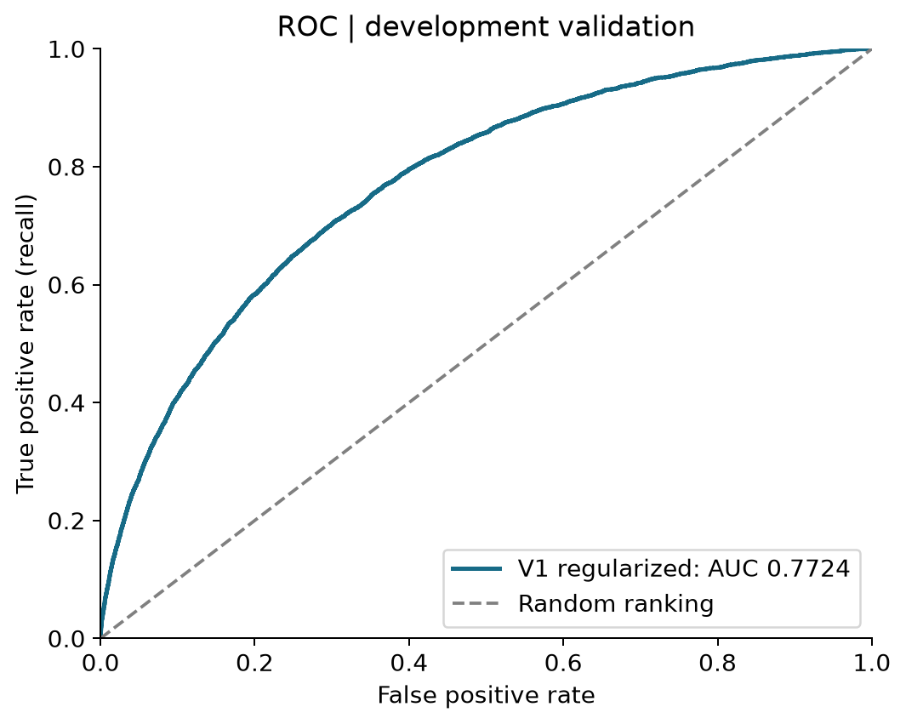
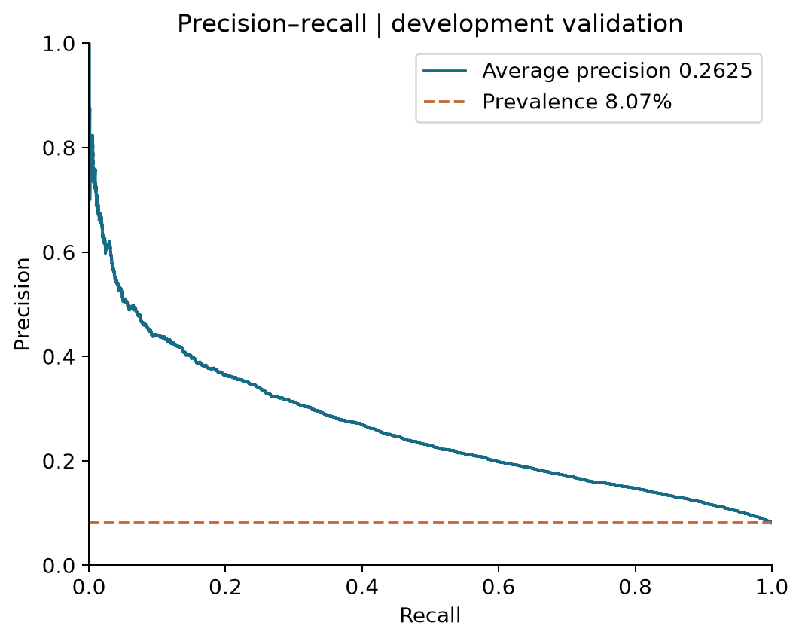
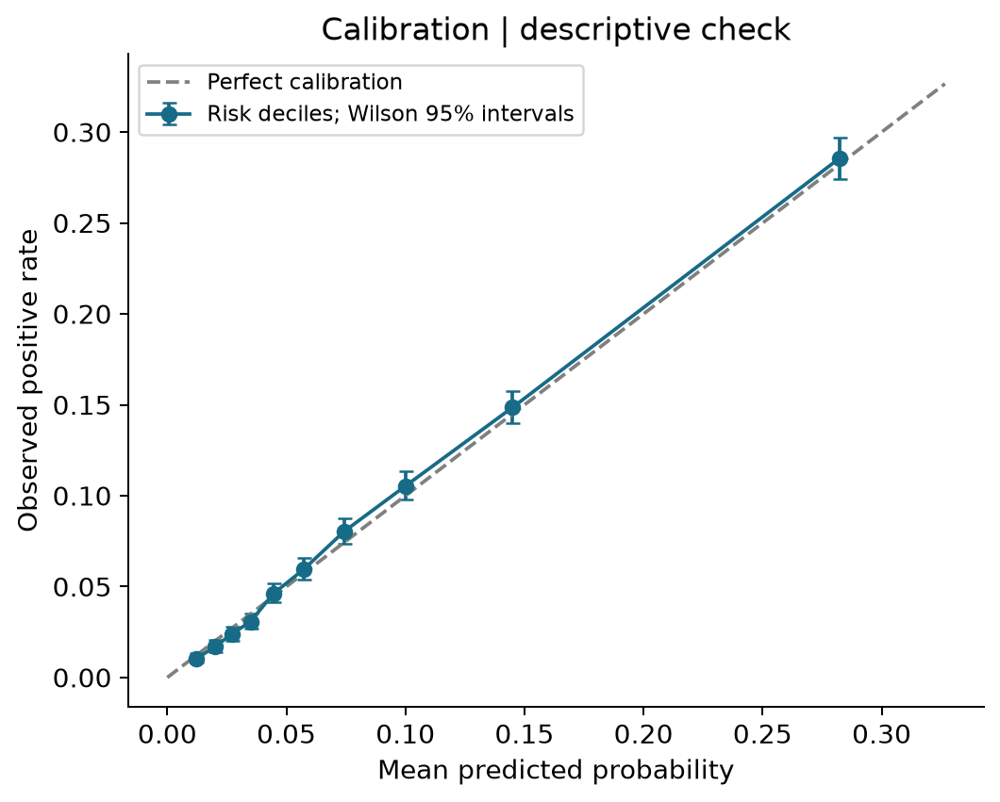
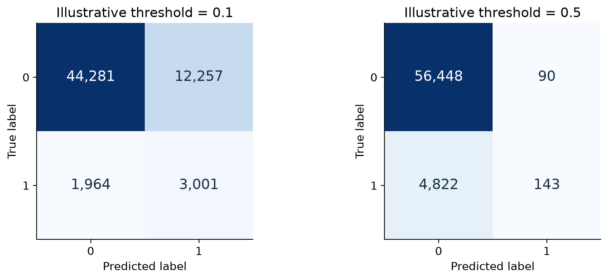
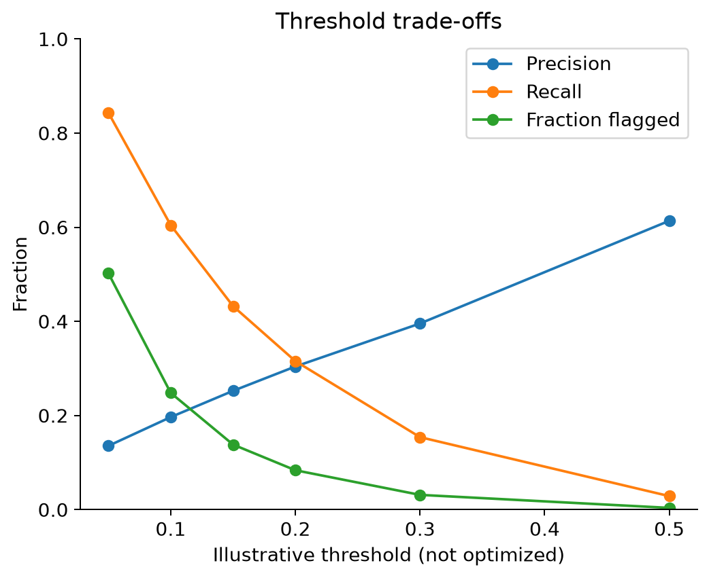
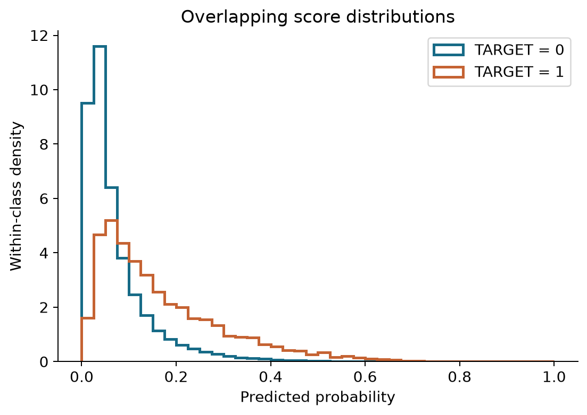
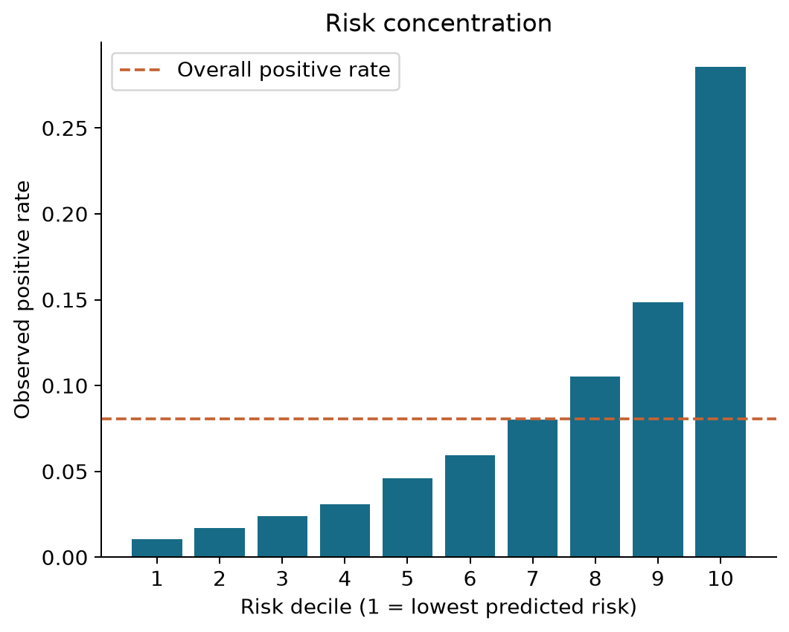
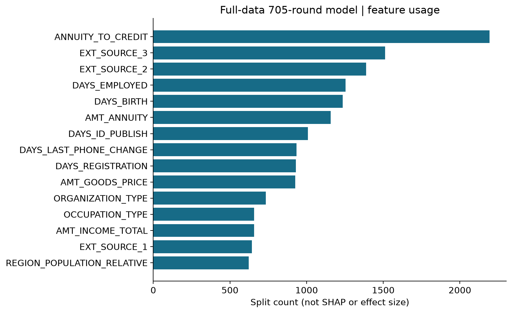

# Home Credit Default Risk
## Model evaluation and integrated project report
**MSDM5054 · SHU Yi, CAO Yixin, ZHANG Yajing, SU Zhiyu**
Repository snapshot: `7dd0957` · 8 October 2026
D evaluation and report integration: SU Zhiyu · Working report for team review

## Abstract
We study prediction of repayment difficulty using the application main table of the Home Credit Default Risk dataset. A reproducible stratified split assigns 246,008 applications to training and 61,503 to validation. The project progresses from logistic regression to LightGBM, then combines feature selection and preprocessing with regularization. The supplied development-validation predictions yield ROC-AUC **0.772396** and average precision (AP) **0.262523**. Positive prevalence is **8.07%**. At a 0.50 threshold, recall is only **2.88%**, despite accuracy of **92.01%**. Lower illustrative thresholds identify more positives at the cost of more false alarms. Validation was used for early stopping, so these are development results rather than an unbiased final test estimate. No Kaggle leaderboard score is available in this snapshot.

## 1. Research questions and data
The project asks whether application information can rank repayment risk; whether the V1 feature and preprocessing package improves on the V0 baseline; and how ranking performance translates into errors at different classification thresholds. TARGET=1 denotes the competition's repayment-difficulty class, referred to here as the positive class. Results do not establish causal effects or prescribe lending decisions.

The official labelled application table contains 307,511 rows and the official test table contains 48,744 rows. The implemented experiments use the application main table only; multi-table aggregation has not been implemented. ID `SK_ID_CURR` and TARGET are excluded from predictor inputs. The fixed split uses seed 42 and stratification by TARGET. D's input contains 61,503 distinct IDs, 4,965 positives and 56,538 negatives. Raw data are not in this source archive. D verified the supplied prediction schema, uniqueness, labels and probability range; independent comparison against canonical raw labels and split membership remains unavailable.

## 2. Data preparation and feature engineering
A implements input-file fingerprints, fixed split reproduction and training-only preprocessing. V0 replaces the DAYS_EMPLOYED sentinel 365243 with missing values, applies log1p to four monetary variables, drops features with over 80% training missingness, and uses numeric imputation/scaling plus categorical one-hot encoding. The logistic classifier is part of a single fitted pipeline.

B's training-partition EDA identifies missingness patterns, extreme values, near-constant fields and correlated feature groups. The V1 decision list retains 65 original features, removes 55 and adds ANNUITY_TO_CREDIT. Thus 66 raw features become 83 numeric model inputs after additional indicators. V1 changes the preprocessing package as well as feature selection: training-fitted caps and bins, rare-category merging, cross-fitted target encoding for two high-cardinality fields, and ordinal encoding for other categories. Therefore the V0-to-V1 improvement cannot be attributed solely to the single ratio feature. B's univariate screening and permutation analysis emphasize the external-source scores, but such associations are not causal and do not prove the absence of all leakage.

## 3. Models and validation design
C trains logistic regression and LightGBM on the fixed training partition. Five-fold stratified CV is conducted within the 246,008-row training partition, with learned preprocessing refitted per fold. The feature decision list itself was selected before inner CV using the wider training partition, so this is not nested evaluation of feature selection. Three CV configurations compare baseline, regularized and class-weighted LightGBM.

The regularized experiment reports mean AUC 0.766092 and sample standard deviation 0.002189. Its average best iteration is 705. The corrected class-weighted experiment reports 0.765550, so weighting was not retained. This small observed difference is not evidence of statistical significance. Baseline/regularized CV code did not explicitly restrict early stopping to AUC alone, while the corrected weighted run did; a strict controlled tuning comparison would standardize that setting.

**Two model objects must be distinguished.** The fixed-validation model used validation-set early stopping and selected **892** rounds. Its predictions are evaluated below. A separate model was fitted on all 307,511 labelled rows using **705** rounds selected from CV. The saved full-data model expects 83 preprocessed columns and has no independent validation score. The exported metadata stores its configuration alongside the earlier validation AUC; these should not be read as one evaluation of a 705-round model.

## 4. Metrics and reproducibility
ROC-AUC measures positive-versus-negative ranking. AP summarizes precision-recall performance; AP here uses `average_precision_score` and is not trapezoidal PR-AUC. Precision measures the positive fraction among flagged applications; recall measures the fraction of all positives found. Brier score and log loss assess probability quality (lower is better). Accuracy is inadequate alone: predicting every application negative achieves **91.93%** while finding zero positives.

D independently recomputed metrics from C's record-level predictions. A stratified percentile bootstrap with 500 replicates and seed 42 gives an AUC interval of **[0.7655, 0.7795]**. This interval is conditional on the existing predictions; it does not account for training variability, feature/model selection or validation reuse. Risk-decile rate intervals use Wilson intervals and are likewise descriptive. File hashes and runtime versions are recorded in `results/d/provenance.json`.

## 5. Model comparison
| Experiment | Fixed validation AUC | CV mean AUC |
|---|---:|---:|
| V0 Logistic Regression | 0.751239 | — |
| V0 LightGBM | 0.759364 | — |
| V1 LightGBM baseline | 0.769522 | 0.763755 |
| V1 Regularized LightGBM | 0.772396* | 0.766092 |
| V1 Regularized + class weight (corrected) | — | 0.765550 |

*892-round validation-early-stopped model. Fixed-split baseline uses 300 rounds; CV uses early stopping, so entries are separate experiments rather than identical fitted models. All historical values are supplied by C; D recomputed the final validation AUC. The observed AUC change from logistic regression to this selected development model is +0.021157. The V1 baseline improves on V0 LightGBM by +0.010158 using rounded values. These are descriptive changes, not paired significance tests.

## 6. Ranking and probability quality
| Measure | D recomputed value |
|---|---:|
| ROC-AUC | 0.772396 |
| Average precision | 0.262523 |
| Positive prevalence / random-ranking PR reference | 0.080728 |
| Brier score | 0.066919 |
| Constant validation-prevalence Brier reference | 0.074211 |
| Log loss | 0.241821 |
| Mean predicted probability | 0.079751 |

The prevalence reference is descriptive and estimated on this evaluation set; it is not a separately trained baseline. Mean predicted probability is close to observed prevalence, but this alone does not establish calibration for all score ranges or customer subgroups.

## 7. Thresholds and error analysis
Thresholds were specified as illustrative comparisons rather than selected by maximizing a validation metric. Class 1 is predicted when PRED_PROB is greater than or equal to the threshold.

| Threshold | True positive | False positive | False negative | Precision | Recall | Fraction flagged |
|---|---:|---:|---:|---:|---:|---:|
| 0.05 | 4,187 | 26,700 | 778 | 13.56% | 84.33% | 50.22% |
| 0.10 | 3,001 | 12,257 | 1,964 | 19.67% | 60.44% | 24.81% |
| 0.15 | 2,147 | 6,358 | 2,818 | 25.24% | 43.24% | 13.83% |
| 0.20 | 1,567 | 3,585 | 3,398 | 30.42% | 31.56% | 8.38% |
| 0.30 | 765 | 1,169 | 4,200 | 39.56% | 15.41% | 3.14% |
| 0.50 | 143 | 90 | 4,822 | 61.37% | 2.88% | 0.38% |

At 0.50, the model flags only 233 applications and misses 4,822 of the 4,965 positives. Its 92.01% accuracy therefore conceals poor positive detection. At 0.10, recall rises to 60.44%, but 12,257 negative applications are flagged and precision is 19.67%. Neither setting is a recommended business threshold. A future threshold should be selected using training-side out-of-fold predictions and explicit error costs or capacity, then evaluated on fresh data.

The two classes' score distributions overlap, explaining both false positives and low-score false negatives. At threshold 0.10, false negatives have median predicted probability 0.0583, while false positives have median 0.1531. These are score-based error descriptions; the available inputs cannot support claims that particular ages, incomes or occupations are disproportionately misclassified.

## 8. Risk concentration and interpretation
The highest-risk decile contains 6,151 applications and 1,756 positives. Its observed positive rate is **28.55%**, about **3.54 times** the overall rate, and it contains **35.37%** of all positives. The lowest-risk decile has a positive rate of 1.04%. These groups are defined from validation prediction quantiles for descriptive analysis, not as production cutoffs.

C's saved importance values are LightGBM **split counts**, based on the full-data 705-round model. ANNUITY_TO_CREDIT leads this ranking, followed by EXT_SOURCE_3, EXT_SOURCE_2, DAYS_EMPLOYED and DAYS_BIRTH. Split counts describe feature usage; they can favor variables offering many splits, do not measure direction or causal effect, and should not be interpreted as SHAP values. B's permutation ranking uses a different model and method and is not numerically comparable.

## 9. Limitations and next steps
1. The reported validation set was inspected during development and used for early stopping. Results are not an untouched test estimate. Re-evaluating a frozen 705-round configuration on the same set would improve configuration alignment, but would not undo prior reuse.
2. Feature selection precedes inner CV; foldwise preprocessing alone does not make the whole pipeline a nested validation procedure. Early-stopping criteria also differ across some CV experiments.
3. D has one model's record-level validation predictions. Historical AUC comparisons use supplied tables; paired ROC curves, paired bootstrap differences and significance tests require the other models' predictions on the same IDs.
4. Raw customer features and canonical labels are unavailable in the archive. Customer-feature subgroup error analysis and independent split/label matching remain follow-up work.
5. SHAP is optional and not performed. The saved estimator alone is insufficient for reproducible raw-row explanations because fitted preprocessing and a matching feature matrix are not included. Explain the evaluated model only after obtaining the matching artifacts from C.
6. This implementation uses the application table only. Temporal generalization, fairness across relevant groups and performance on new populations have not been established. No leaderboard score is recorded.

## 10. Conclusions
The available development evidence supports improved ranking after replacing logistic regression with LightGBM and adopting the V1 feature/preprocessing package. However, useful ranking does not imply effective positive detection at a default threshold of 0.50. The D evaluation adds reproducible ranking, probability-quality, threshold and score-based error analyses, while explicitly separating the evaluated 892-round model from the final 705-round full-data model. Stronger generalization claims require fresh evaluation and consistent model-selection procedures.

## 11. Contributions and evidence
| Member | Repository contribution |
|---|---|
| SHU Yi | Data entry, fixed split, shared V0 preprocessing/baseline integration, submission validation |
| CAO Yixin | Training-partition EDA, feature decisions and analysis figures |
| ZHANG Yajing | LightGBM, CV/tuning, full-data model and prediction handoff |
| SU Zhiyu | D metrics, nine figures, threshold/score-based errors, integrated report and reproducibility checks |

Evidence: original `README.md`; `docs/division-of-labor.md`; `src/data_pipeline.py`; `src/baseline.py`; `docs/eda/eda_findings.md`; `docs/eda/column_decisions.md`; `notebooks/C_modeling.ipynb` cells 15–26; and `results/c/` artifacts, from [repository snapshot](https://github.com/slowdowndown/msdm5054-home-credit/tree/7dd0957906a3a67b8f8a77f2b0a8188c80944675). The source notebook is available as notebooks/C_modeling.ipynb in the repository for audit. Final course formatting, page limits and team sign-off remain to be confirmed; this report does not claim those administrative requirements are satisfied.
